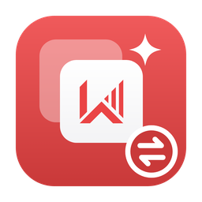
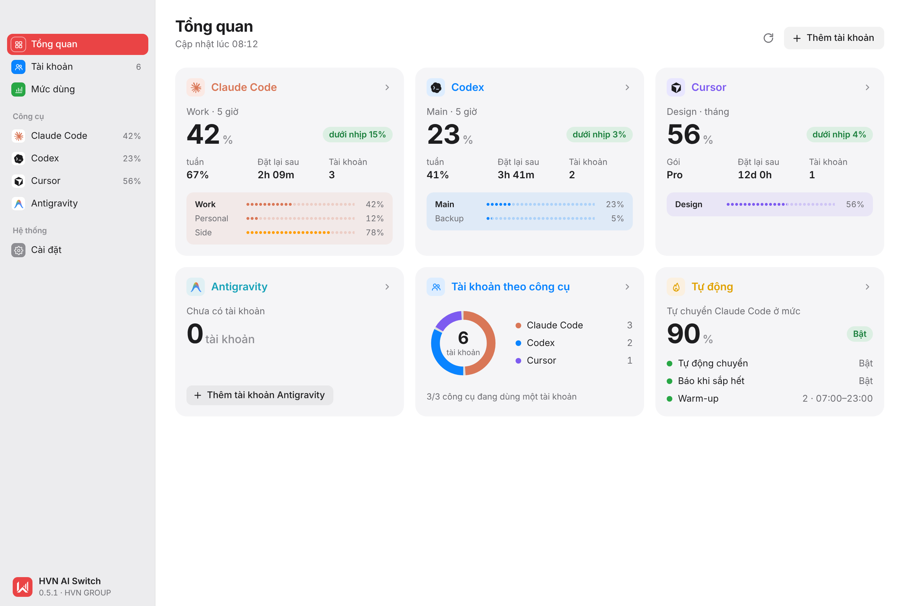
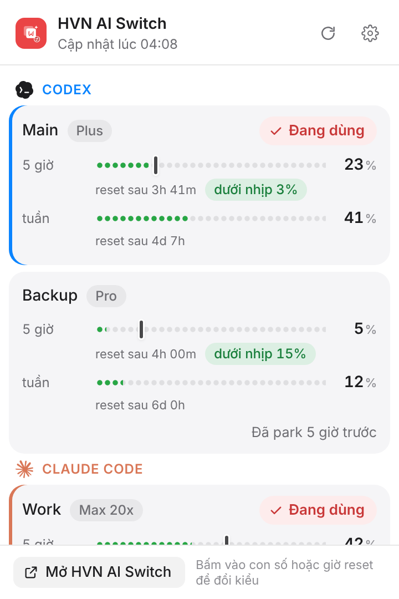
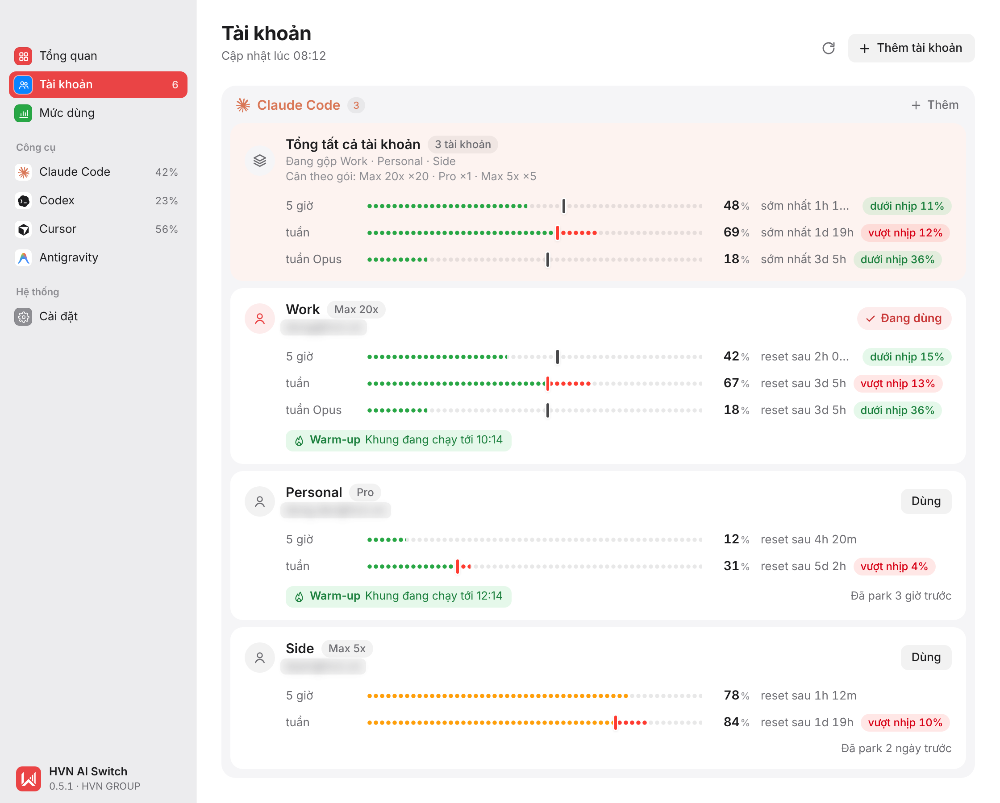
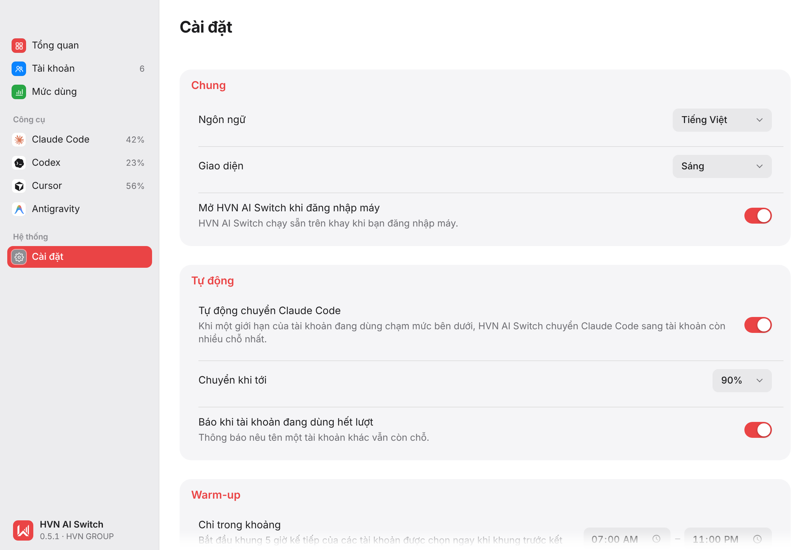

<div align="center">



# HVN AI Switch

**Chuyển giữa các tài khoản Claude Code, Codex, Cursor và Antigravity chỉ bằng một cú
bấm — không cần đăng xuất — và xem mỗi tài khoản còn bao nhiêu hạn mức.**

[](https://github.com/hvngroup/app-ai-switch-releases/releases/latest)


[](LICENSE)

**[Tải bản mới nhất](https://github.com/hvngroup/app-ai-switch-releases/releases/latest)** ·
[Cài đặt](#cài-đặt) · [Sử dụng](#sử-dụng) · [Báo lỗi](https://github.com/hvngroup/app-ai-switch-releases/issues/new/choose)

Phát triển bởi **[HVN GROUP](https://hvn.vn)** · Hỗ trợ: kythuat@hvn.vn

</div>

---

HVN AI Switch là ứng dụng nằm trên thanh menu (macOS) hoặc khay hệ thống (Windows, Linux), kèm
công cụ dòng lệnh `hvn-switch`, dành cho cá nhân và đội ngũ dùng nhiều tài khoản **Claude
Code**, **Codex**, **Cursor** hoặc **Antigravity**:

- **Đổi tài khoản ngay** từ menu; các phiên Claude Code đang mở tự dùng tài khoản mới.
- **Popover mức dùng** trên thanh menu (từ bản 0.8.0): bấm biểu tượng hoặc phím tắt `⌥⌘U`
  / `Alt+Ctrl+U` để xem hạn mức của mọi tài khoản, thời điểm reset, nhịp dùng và chuyển
  tài khoản ngay. Thanh menu hiển thị tài khoản đang dùng, hoặc tối đa hai hạn mức tự chọn
  dạng chữ hay thanh mini vẽ ngay trên biểu tượng.
- **Trang Tổng quan** theo phong cách trình theo dõi hệ thống của macOS: mỗi công cụ một
  thẻ với tài khoản đang dùng, hạn mức dạng số lớn và dải chấm cho từng tài khoản.
- **Xem hạn mức của mọi tài khoản**: 5 giờ, tuần, tháng, theo từng model; bao lâu nữa đặt
  lại và bạn đang dùng nhanh hay chậm hơn nhịp đều.
- **Tổng tất cả tài khoản**: gộp các tài khoản của một công cụ để xem cả nhóm còn bao
  nhiêu. Mỗi tài khoản được cân theo cỡ gói (Max 20x tính gấp 20 lần Pro).
- **Tự động chuyển** Claude Code sang tài khoản còn nhiều hạn mức nhất khi tài khoản đang
  dùng sắp hết, và **Warm-up** để mở sẵn khung 5 giờ kế tiếp.
- **Mức dùng và chi phí** ước tính theo giá API, đọc từ log ngay trên máy.
- **Riêng tư**: không có máy chủ, không thu thập dữ liệu. Login được mã hoá AES-256-GCM
  trên máy, khoá nằm trong Keychain (macOS), Credential Manager (Windows) hoặc keyring của
  hệ thống (Linux). Mỗi login chỉ được gửi tới chính dịch vụ đã cấp nó.

Giao diện tiếng Việt (mặc định) và tiếng Anh; giao diện sáng và tối.

<p align="center">
  <picture>
    <source media="(prefers-color-scheme: dark)" srcset="assets/screenshots/hvn-overview-dark.png">
    
  </picture>
</p>

<table>
  <tr>
    <td width="34%" valign="top">
      <picture>
        <source media="(prefers-color-scheme: dark)" srcset="assets/screenshots/hvn-popover-dark.png">
        
      </picture>
      <p align="center"><b>Popover mức dùng</b>: mọi tài khoản ngay trên thanh menu</p>
    </td>
    <td width="66%" valign="top">
      <picture>
        <source media="(prefers-color-scheme: dark)" srcset="assets/screenshots/hvn-accounts-dark.png">
        
      </picture>
      <p align="center"><b>Tài khoản</b>: từng tài khoản với hạn mức, nhịp dùng và thời điểm đặt lại</p>
      <picture>
        <source media="(prefers-color-scheme: dark)" srcset="assets/screenshots/hvn-settings-dark.png">
        
      </picture>
      <p align="center"><b>Cài đặt</b>: tự động chuyển trước khi hết, warm-up khung kế tiếp</p>
    </td>
  </tr>
</table>

<sub>Ảnh chụp dùng dữ liệu mẫu.</sub>

> Repo này chỉ chứa bản phát hành và kênh cập nhật của ứng dụng. Mã nguồn được quản lý
> riêng tại HVN GROUP.

## Tải về

Tải bản mới nhất ở trang [Releases](https://github.com/hvngroup/app-ai-switch-releases/releases/latest):

| Máy | File |
|---|---|
| Mac chip Apple (M1 trở lên) | `HVNAISwitch-macos-arm64.dmg` |
| Mac Intel | `HVNAISwitch-macos-x64.dmg` |
| Windows 10/11 (64-bit) | `HVNAISwitch-windows-x64-setup.exe` hoặc bản portable `.zip` |
| Windows 11 trên chip ARM | `HVNAISwitch-windows-arm64-setup.exe` hoặc bản portable `.zip` |
| Linux (x64) | `HVNAISwitch-linux-x64.AppImage` hoặc `HVNAISwitch-linux-x64.deb` |
| Dòng lệnh `hvn-switch` | `hvn-switch-cli-macos-arm64.tar.gz`, `-macos-x64`, `-linux-x64` (bản Windows nằm trong file portable) |

Mỗi file có một file `.sha256` đi kèm để đối chiếu. Các file `latest.json`, `*.sig` và
`HVNAISwitch-macos-*.app.tar.gz` dành cho trình cập nhật của ứng dụng; anh/chị không cần
tải chúng để cài.

## Cài đặt

**macOS 11 trở lên.** Mở file `.dmg`, kéo **HVN AI Switch** vào **Applications** rồi mở.
Bản phát hành được ký bằng Developer ID của HVN GROUP và đã qua notarize của Apple, nên mở
được ngay. Ứng dụng nằm trên thanh menu, không có biểu tượng ở Dock cho tới khi mở cửa sổ.

Bản trước 0.7.0 chưa notarize. Nếu macOS chặn: bấm **Done** (đừng bấm **Move to Trash**),
vào **System Settings → Privacy & Security** và bấm **Open Anyway**. Nếu macOS báo ứng dụng
"is damaged", chạy lệnh sau trong Terminal rồi mở lại:
`xattr -dr com.apple.quarantine "/Applications/HVN AI Switch.app"`

**Windows 10/11.** Chạy file `-setup.exe`; bản portable thì giải nén file `.zip` rồi chạy
`HVN AI Switch.exe`. Bản Windows chưa ký số: SmartScreen báo ứng dụng lạ thì bấm **More info
→ Run anyway**.

**Linux.** AppImage: `chmod +x HVNAISwitch-linux-x64.AppImage` rồi chạy. Gói `.deb`:
`sudo apt install ./HVNAISwitch-linux-x64.deb`. Biểu tượng trên thanh hệ thống cần
AppIndicator (GNOME: cài extension AppIndicator), và login được giữ trong keyring của hệ
thống (GNOME Keyring hoặc KWallet).

**Cần có sẵn.** Máy cần cài và đăng nhập một lần các công cụ muốn quản lý:
[Claude Code](https://docs.anthropic.com/en/docs/claude-code),
[Codex CLI](https://github.com/openai/codex), [Cursor](https://cursor.com) và/hoặc
[Antigravity](https://antigravity.google). Với Codex, ứng dụng cũng dùng được lệnh `codex`
có sẵn trong `Codex.app`.

## Sử dụng

- **Bấm chuột trái vào biểu tượng** (macOS, Windows) hoặc nhấn phím tắt (mặc định `⌥⌘U`,
  trên Windows/Linux `Alt+Ctrl+U`) để mở **popover mức dùng**. Bấm vào một tài khoản để
  chuyển sang; bấm vào con số để đổi giữa phần đã dùng và phần còn lại, bấm vào giờ reset
  để đổi giữa đếm ngược và giờ trong ngày. Bấm ra ngoài hoặc `Esc` để đóng.
- **Bấm chuột phải** (trên Linux: bấm bất kỳ) để mở menu: tài khoản theo công cụ, dấu tích
  ở tài khoản đang dùng, mỗi hạn mức một dòng và gợi ý chuyển khi tài khoản đang dùng hết
  hạn mức.
- **Mở HVN AI Switch** để mở cửa sổ: **Tổng quan**, **Tài khoản** (bấm chuột phải vào một
  tài khoản để **Đăng nhập lại**, **Đổi tên** hoặc **Quên**), **Mức dùng** và **Cài đặt**
  (ngôn ngữ, giao diện, **Menu bar**, cập nhật, tự động chuyển, warm-up).
- **Thêm tài khoản** bằng nút **Thêm tài khoản** trong ứng dụng. **Đừng** dùng `/login` của
  Claude Code hay `codex login` (chúng thay luôn tài khoản đang dùng), và **đừng** đăng xuất
  trong các công cụ (đăng xuất huỷ login đã lưu).
  - **Cursor**: ứng dụng mở trang đăng nhập chính thức của Cursor trong trình duyệt. Muốn
    thêm tài khoản khác tài khoản đang đăng nhập trên trình duyệt thì dùng cửa sổ ẩn danh.
  - **Antigravity**: ứng dụng mở một cửa sổ Antigravity riêng để đăng nhập Google, xong thì
    tự đóng.
- Đóng cửa sổ thì ứng dụng vẫn nằm trên thanh menu; **Thoát** nằm trong menu.

**Dòng lệnh:**

```sh
hvn-switch enroll work --provider claude-code                 # lưu login công cụ đang dùng
hvn-switch enroll personal --provider claude-code --sign-in   # đăng nhập thêm tài khoản khác
hvn-switch                                                    # liệt kê tài khoản và mức dùng
hvn-switch use work                                           # chuyển tài khoản
```

## Cập nhật

Bản cài bằng setup (Windows), bản trong Applications (Mac) và AppImage (Linux) tự tìm bản
mới từ repo này và cài khi anh/chị đồng ý; tắt được trong **Cài đặt → Cập nhật**. Bản
portable và gói `.deb` cập nhật bằng tay. Mọi bản cập nhật đều phải mang chữ ký bằng khoá
cập nhật của HVN thì ứng dụng mới cài.

**Đang dùng bản 0.6 hoặc 0.7?** Các bản này tìm cập nhật ở địa chỉ cũ, nay không còn dùng.
Hãy tải bản mới nhất ở trên về và cài đè một lần; từ đó ứng dụng tự cập nhật từ repo này.
Tài khoản và cài đặt được giữ nguyên.

## Riêng tư và bảo mật

- **Không có máy chủ của HVN, không thu thập dữ liệu sử dụng.** Login đã lưu được mã hoá
  AES-256-GCM ngay trên máy, khoá nằm trong kho khoá của hệ điều hành.
- **Mỗi login chỉ được gửi tới chính nơi đã cấp nó** (Anthropic, OpenAI hoặc Cursor) để đọc
  hạn mức của tài khoản đó.
- **Kết nối khác:** bảng giá công khai của LiteLLM (không gửi gì) và trang phát hành của
  repo này để xem có bản mới không.

Chi tiết: [SECURITY.md](SECURITY.md).

## Giới hạn hiện tại

- Chưa hỗ trợ Claude Desktop. Tự động chuyển và warm-up chỉ áp dụng cho Claude Code.
- Hỗ trợ Cursor và Antigravity dựa trên dữ liệu mà ứng dụng của họ tự lưu, không được công
  bố chính thức nên có thể thay đổi. Antigravity 2.0 (ứng dụng desktop và lệnh `agy`) lưu
  login ở chỗ khác và chưa chuyển được.
- Claude Code trên Windows có thể chuyển sang Credential Manager (sau một cờ tính năng);
  khi đó ứng dụng không thấy login đó.

## Báo lỗi và hỗ trợ

- **Báo lỗi hoặc góp ý:** mở [issue](https://github.com/hvngroup/app-ai-switch-releases/issues/new/choose),
  ghi kèm phần **Cài đặt → Giới thiệu → Sao chép thông tin** của ứng dụng.
- **Lỗ hổng bảo mật:** gửi qua
  [security advisory riêng](https://github.com/hvngroup/app-ai-switch-releases/security/advisories/new),
  đừng mở issue công khai.
- **Hỗ trợ kỹ thuật:** `kythuat@hvn.vn · Hotline 024.9999.7777`

## Giấy phép

Phát hành theo [giấy phép MIT kèm Commons Clause](LICENSE): được dùng (kể cả cho công việc),
sửa và chia sẻ lại, giữ nguyên thông báo giấy phép, nhưng **không được bán** phần mềm này,
bản sửa đổi của nó, hay dịch vụ thu phí mà giá trị chủ yếu đến từ nó.

Ứng dụng không liên kết với và không được bảo trợ bởi Anthropic, OpenAI, Anysphere hay
Google. Claude và Claude Code là nhãn hiệu của Anthropic; Codex và ChatGPT của OpenAI;
Cursor của Anysphere; Antigravity và Gemini của Google. Logo của họ chỉ dùng để gọi tên công
cụ (xem [THIRD_PARTY_NOTICES](THIRD_PARTY_NOTICES.md)).

---

<sub>HVN GROUP · [hvn.vn](https://hvn.vn)</sub>
